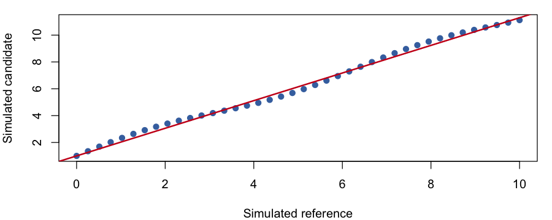
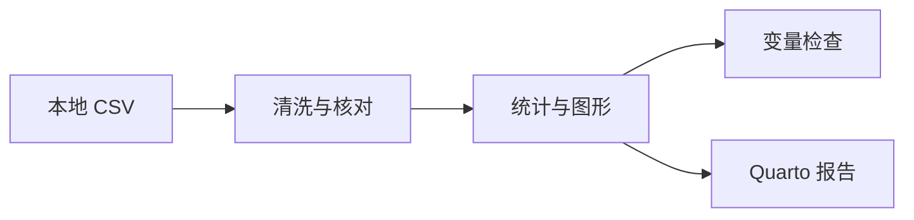

# 使用说明

此文档使用**固定种子的模拟数据**。在 Rnotebook 中打开后，可以直接“运行全部”。只读取旁边的 `measurements.csv` 和本地图片，不联网、不安装包、不覆盖用户文件。

建议依次体验：Code／Visual 切换、标题与代码块折叠、查找替换、运行、变量预览、格式化、保存重开及 Quarto 渲染。最后应看到 `FEATURE_VALIDATION_OK`。

> 此处是普通引用。示例中的错误边界和长文档分别放在另外两份文件中，避免影响本文的完整运行。

## 编辑工具与文字样式

**粗体**、*斜体*、~~删除线~~、`行内代码`、==高亮文字==、[R 官方文档](https://www.r-project.org/)、上标 x^2^ 与下标 H~2~O。

Unicode 样例：中文标点，emoji 😀🧪，预组合 café，组合字符 café。后两项看起来相同，但源文件字节不同，保存与外部合并都应保留。

- 无序列表第一项
- 第二项，带 **强调**
  - 嵌套条目

1. 有序步骤一
2. 有序步骤二

- [x] 文档和素材均为本地文件
- [ ] 手动核对菜单、搜索与导出

| 列类型 | 示例 | 期望 |
|:--|:--|:--|
| 中文 | 样本甲 | 正常显示 |
| 前导零 | 00001 | 读为字符 |
| 特殊字符 | 逗号、引号、换行 | CSV 字段完整 |
| Unicode | café / café / 😀 | 源码字节不丢失 |

## 公式、图示与本地图片

行内公式 $y_i = \alpha + \beta x_i + \epsilon_i$，以及独立公式：

$$
\bar{x}=\frac{1}{n}\sum_{i=1}^{n}x_i,\qquad
s^2=\frac{1}{n-1}\sum_{i=1}^{n}(x_i-\bar{x})^2
$$





::: {.callout-note}
## 原生提示块

此处应作为提示内容阅读。相同文件可用于 Finder 源代码／可视化预览，预览不得运行代码。
:::

> [!TIP] 扩展提示
> 开启 Edmund 兼容后，导出时应转换此提示、==高亮==和 wiki 链接，源文件保持原样。

[[#数据导入与检查|跳到数据导入]]。%% 这是编辑器兼容注释，导出时应隐藏。 %%

# 数据导入与检查

```{r}
#| label: feature-setup
feature_runs <- if (exists("feature_runs", inherits = FALSE)) feature_runs + 1L else 1L
set.seed(20261114)
stopifnot(requireNamespace("knitr", quietly = TRUE))
cat("FEATURE_SETUP_OK run=", feature_runs, "\n", sep = "")
message("FEATURE_EXPECTED_MESSAGE：这是预期消息")
warning("FEATURE_EXPECTED_WARNING：这是预期警告", call. = FALSE)
```

```{r}
#| label: feature-import
raw <- read.csv("measurements.csv", colClasses = c("character", "character", "numeric", "numeric", "character"),
                na.strings = "NA", fileEncoding = "UTF-8", check.names = FALSE)
stopifnot(nrow(raw) == 180L, raw$sample_id[1L] == "00001", grepl("中文", raw$note[1L]), grepl("\n", raw$note[2L]))
raw$site <- factor(raw$site, levels = c("Site A", "Site B", "Site C"))
paired <- raw[is.finite(raw$reference) & is.finite(raw$candidate), , drop = FALSE]
paired$difference <- paired$candidate - paired$reference
cat("FEATURE_IMPORT_OK raw=", nrow(raw), " paired=", nrow(paired), "\n", sep = "")
head(raw, 5)
```

```{r}
#| label: feature-summary
audit <- do.call(rbind, lapply(levels(raw$site), function(site) {
  rows <- raw$site == site
  data.frame(Site = site, Total = sum(rows), Complete = sum(is.finite(raw$reference[rows]) & is.finite(raw$candidate[rows])))
}))
knitr::kable(audit, caption = "三个中心的完整配对核对", row.names = FALSE)
```

```{r}
#| label: feature-model
fit <- lm(candidate ~ reference, data = paired)
model_table <- cbind(Estimate = coef(fit), confint(fit))
knitr::kable(model_table, digits = 4, caption = "模拟数据线性模型")
print(summary(fit))
```

```{r}
#| label: feature-bootstrap
bootstrap_runs <- 1L
set.seed(20261114)
boot <- replicate(400, mean(sample(paired$difference, replace = TRUE)))
interval <- quantile(boot, c(0.025, 0.975))
knitr::kable(data.frame(Replicates = length(boot), Mean = mean(paired$difference), Lower = interval[1], Upper = interval[2]),
             digits = 4, row.names = FALSE, caption = "固定种子的模拟重采样")
```

# 图形与富结果

```{r}
#| label: feature-base-plot
#| fig-width: 7
#| fig-height: 4
#| fig-dpi: 144
plot(paired$reference, paired$candidate, pch = 19, col = "#4271AE", xlab = "Reference", ylab = "Candidate")
abline(fit, col = "#CB181D", lwd = 2)
```

```{r}
#| label: feature-multiple-plots
local({
  old <- par(mfrow = c(1, 2), mar = c(4, 4, 1, 1))
  on.exit(par(old))
  hist(boot, breaks = 20, col = "#9ECAE1", main = "", xlab = "Bootstrap mean")
  boxplot(difference ~ site, data = paired, col = "#C6DBEF", xlab = "Site", ylab = "Difference")
})
```

```{r}
#| label: feature-ggplot
if (requireNamespace("ggplot2", quietly = TRUE)) {
  p <- ggplot2::ggplot(paired, ggplot2::aes(reference, candidate, colour = site)) +
    ggplot2::geom_point(size = 1.6, alpha = 0.8) + ggplot2::theme_minimal() +
    ggplot2::labs(title = "Simulated paired measurements")
  print(p)
} else {
  cat("OPTIONAL_PACKAGE_MISSING ggplot2\n")
}
```

```{r}
#| label: feature-flextable
if (requireNamespace("flextable", quietly = TRUE)) {
  rich_table <- flextable::flextable(audit)
  rich_table <- flextable::add_header_lines(rich_table, values = "合并标题：模拟记录审计")
  rich_table <- flextable::theme_vanilla(rich_table)
  rich_table <- flextable::autofit(rich_table)
  rich_table
} else {
  cat("OPTIONAL_PACKAGE_MISSING flextable\n")
}
```

# 变量预览的各类对象

```{r}
#| label: feature-object-types
scalar <- 42
unicode_text <- paste(rep("长文本：中文 😀 café café", 24), collapse = "\n")
named_vector <- setNames(seq_len(125), sprintf("item_%03d", seq_len(125)))
numeric_matrix <- matrix(seq_len(30), nrow = 5, dimnames = list(paste0("row", 1:5), paste0("col", 1:6)))
category <- factor(c("alpha", "beta", NA, "alpha"))
empty_vector <- numeric()
empty_frame <- data.frame(value = numeric(), label = character())
nested <- list(summary = audit, model = list(coefficients = coef(fit), matrix = numeric_matrix),
               text = unicode_text, long = as.list(named_vector), empty = list())
wide_frame <- as.data.frame(setNames(rep(list(seq_len(40)), 24), paste0("column_", 1:24)))
cat("FEATURE_OBJECTS_OK\n")
```

```{r}
#| label: feature-output-edge
cat("stdout：第一行\n第二行，逗号，引号\"，emoji 😀\n")
print(c(NA_real_, NaN, Inf, -Inf))
print(matrix(numeric(), nrow = 0, ncol = 2))
invisible(999)
```

## 静态执行规则

下块是批量跳过示例。运行全部不得触发其中的 stop，手动运行则由用户明确选择。

```{r}
#| label: feature-skipped
#| eval: false
stop("FEATURE_SKIPPED_BLOCK_MUST_NOT_RUN")
```

## 格式化体验

可将光标放到下块，用块旁格式按钮或 Shift-Command-I 格式化，再撤销一次。格式化不得启动或重复运行 R。

```{r}
#| label: feature-format
formatted_value<-sum(c( 1,2, 3 ))
stopifnot(formatted_value==6)
```

# 最终检查

```{r}
#| label: feature-checks
stopifnot(nrow(raw) == 180L, nrow(paired) == 175L, sum(audit$Complete) == 175L,
          length(boot) == 400L, bootstrap_runs == 1L, scalar == 42,
          length(named_vector) == 125L, ncol(wide_frame) == 24L,
          coef(fit)[["reference"]] > 0.9, coef(fit)[["reference"]] < 1.2)
cat("FEATURE_VALIDATION_OK raw=180 paired=175 bootstrap=400\n")
```

复核记录：模式切换和查看输出不得增加 `feature_runs`；明确再次“运行全部”才应加一。重新打开笔记默认没有历史结果和活动 R 会话。
